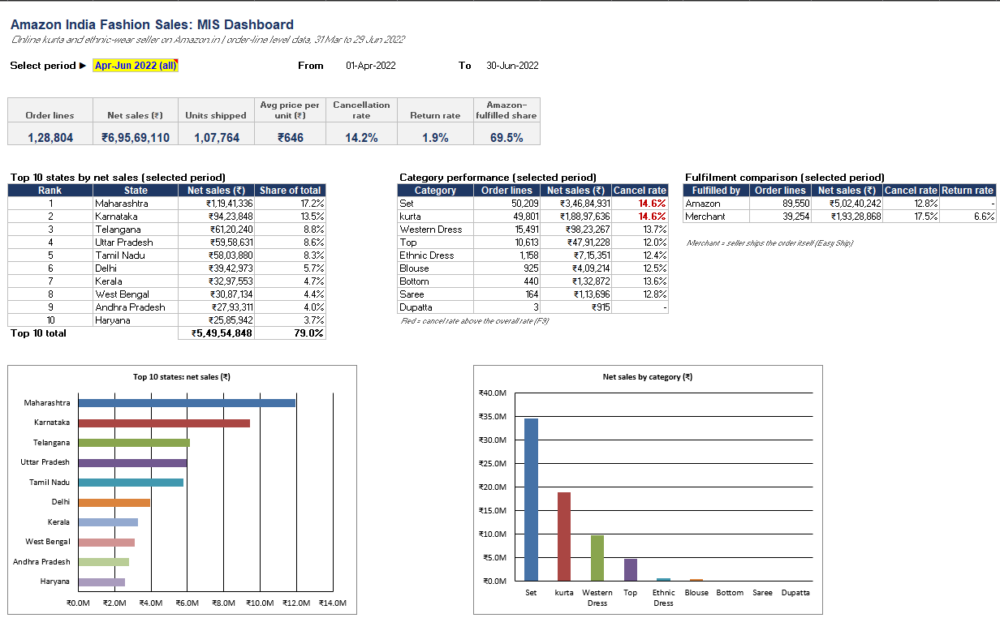

# Amazon India Fashion Sales: MIS Report & Dashboard (Excel)

A monthly MIS report and interactive dashboard, built **entirely in Excel**, for an Indian ethnic-wear seller on Amazon.in. 128,975 order lines, 31 Mar to 29 Jun 2022.

## Business questions
1. How much did we sell each month, and is it growing?
2. How many orders get cancelled or returned, and does it depend on who ships the order?
3. Which states and categories drive sales?

## Data
"Amazon Sale Report" from the E-Commerce Sales Dataset (Kaggle). One row per order line: date, status, fulfilment, category, size, quantity, amount (₹), ship city and state.

## What's in the workbook
| Sheet | What it does |
|---|---|
| Notes | Purpose, how to use it, cleaning steps, definitions, findings |
| Dashboard | Period dropdown (yellow cell) driving 7 KPI cards, top 10 states, category and fulfilment tables, 2 charts |
| Monthly_MIS | Month-by-month MIS: lines, shipped, cancelled, returned, units, net sales, avg price, rates, MoM change, with a check that months add up to the total |
| State_Report | Net sales, share, rank and cancel rate for every state, plus a region summary |
| Category_Report | Category × month net sales matrix, share, Jun vs Apr change, cancel rate |
| Data | Raw data plus 2 formula columns (Clean State, Status Group) |
| Lookups | State clean-up map, status groups, report periods |

## Excel skills used
- **Data cleaning:** state names typed 69 different ways (`RAJASTHAN`, `Rajshthan`, `RJ`, `New Delhi`...) mapped to clean names with `INDEX`/`MATCH` + `UPPER`/`TRIM`; 13 raw statuses grouped into 5 with a lookup table; blanks handled with `IFERROR`.
- **Reporting formulas:** `SUMIFS`, `COUNTIFS` with date ranges, `SUMIF`, `LARGE` + `INDEX`/`MATCH` for a dynamic top 10, `RANK`.
- **Interactivity:** Data Validation dropdown that changes the period for the whole dashboard.
- **Structure:** named ranges (`d_Date`, `d_Amount`, `d_Group`...), lookup tables instead of hardcoded values, reconciliation checks ("OK: months add up").
- **Presentation:** conditional formatting (cancel rate above average in red, data bars on states), frozen panes, filters, charts, Indian rupee number formats.

## Key findings (Apr to Jun 2022)
| | |
|---|---|
| Net sales | ₹6.96 crore from 1,07,437 shipped lines |
| Trend | Net sales fell 8.6% in May and 12.9% in June |
| Cancellations | 14.2% of order lines; Merchant-shipped 17.5% vs Amazon-fulfilled 12.8% |
| States | Top 10 states = 79% of net sales; Maharashtra + Karnataka = 31%; South India = 40% |
| Categories | Sets and kurtas = 77% of net sales, both falling; Western Dress grew 27% (Jun vs Apr) |

## Recommendations
1. Look into why Merchant (Easy Ship) orders cancel more: stock accuracy, dispatch time. Moving fast sellers to Amazon fulfilment could cut cancellations.
2. Focus marketing on the top 5 states, which bring 56% of net sales.
3. Investigate the fall in sets and kurtas, and expand Western Dress, the one growing category.

## Data limitations
- June data stops on 29 June.
- Amazon-fulfilled lines never show a "returned" status, so the return rate only works for Merchant lines.
- No cost data, so no profit.

## How to use
Open `Amazon_India_Sales_MIS.xlsx`, go to **Dashboard**, and pick a period in the yellow cell C5.

**Tip:** take a screenshot of the Dashboard in Excel and add it here as `dashboard.png`. Recruiters look at the picture first.

## Optional: add a Pivot Table (5 minutes, good to show in interviews)
1. Go to the **Data** sheet, click any cell, press **Ctrl + T** to make it a Table.
2. **Insert > PivotTable > New Worksheet**.
3. Rows: *Clean State*. Columns: *Status Group*. Values: *Amount (₹)* (Sum) and *Order ID* (Count).
4. **PivotTable Analyze > Insert Slicer >** *Category* and *Fulfilment*.
5. Check that the Shipped total matches the Dashboard (₹6,95,69,110 for Apr–Jun, plus any 31 March lines).
